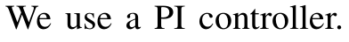
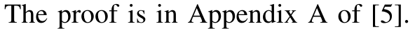
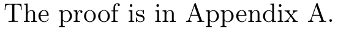
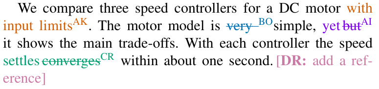
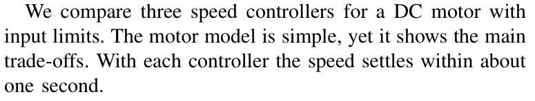
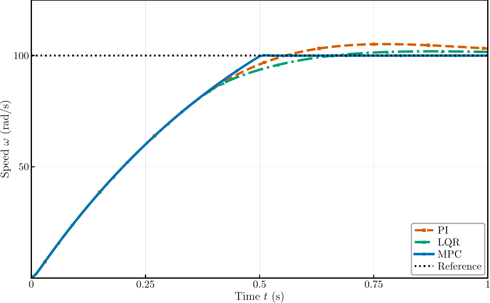
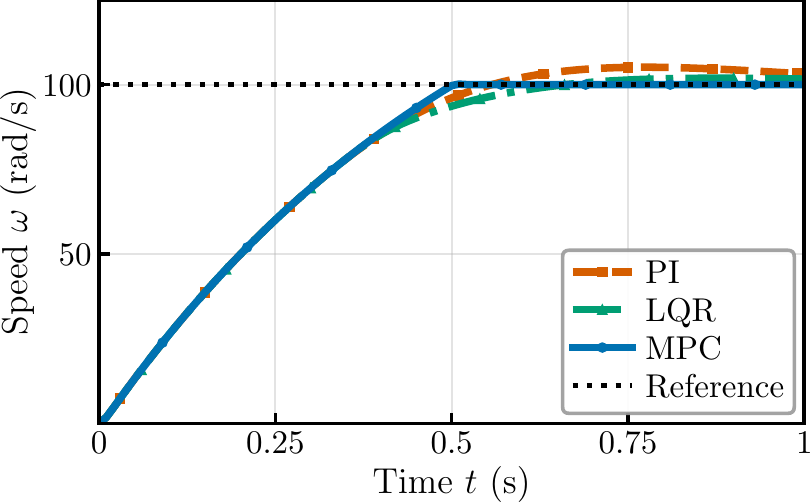
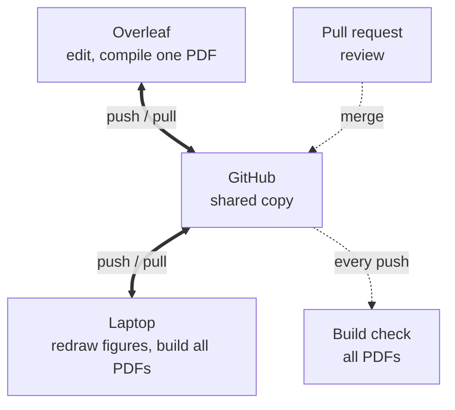

# Paper template

One LaTeX source for the conference, journal and arXiv versions of a paper.
Version toggles and workflow: Omid Mirzaeedodangeh.

[Talk slides](https://github.com/omidmirza/paper-template/releases/download/talk/one-paper-many-versions.pdf) ·
[Explanation page](https://claude.ai/artifact/GZs9ZnwgoJfLEay2WsNLuU) ·
[Command reference](../toggle_helper.tex)

## Examples

| | `\ifversion{conference}{A}{B}` | `\arxivref{app:proofs}` |
|---|---|---|
| Conference |  |  |
| arXiv |  |  |

| | Co-author edits |
|---|---|
| Review copy |  |
| Submitted PDF |  |

| Shrunk to fit | Drawn with `\autofig` |
|---|---|
|  |  |

## Workflow



## Getting started

On Overleaf:

1. With a paid or institutional Overleaf plan (ETH has one): press "Use this template" on this page,
   then on Overleaf choose New Project > Import from GitHub.
   Otherwise: download `template-for-overleaf.zip` from
   [Releases](https://github.com/omidmirza/paper-template/releases/latest), then New Project > Upload Project.
2. Fill in the title, authors and versions in `setup.tex`.
   If you rename the editors `author1` to `author3`, rename them in `sections/intro.tex` too.
3. Press Recompile. `main.tex` shows all versions at once (the review copy).
   For one version, open its file in `versions/` and press Recompile.

On a laptop, to redraw figures and build every version (TeX Live and Python 3.10 or later):

```sh
git clone <your copy> my-paper && cd my-paper
python3 -m venv .github/.venv
.github/.venv/bin/pip install -r .github/python/requirements.txt
make -f .github/Makefile        # every version, into .github/pdf/
```

## Files

| Path | Contents |
|---|---|
| `main.tex` | the paper |
| `setup.tex` | title, authors, versions, co-authors |
| `toggle_helper.tex` | every command, with examples |
| `versions/` | one file per PDF |
| `sections/` | the text |
| `figures/` | figure code and the figures |
| `refs/` | bibliography |
| `.github/` | tools and documentation |

## Working with co-authors

- Add each person with one line in `setup.tex`: `\DeclareEditor{anna}{AK} \editorname{anna}{Anna Keller}`
- For larger changes, work on a branch and open a pull request. GitHub builds every version for each push.
- Overleaf syncs with the `main` branch only.
- Figures are redrawn on a laptop, because Overleaf cannot run Python. Commit `figures/auto/` afterwards.

## Documentation

[Notes](docs/) on versions, edits, figures and the workflow. [Notes for AI assistants](ai/README.md).
